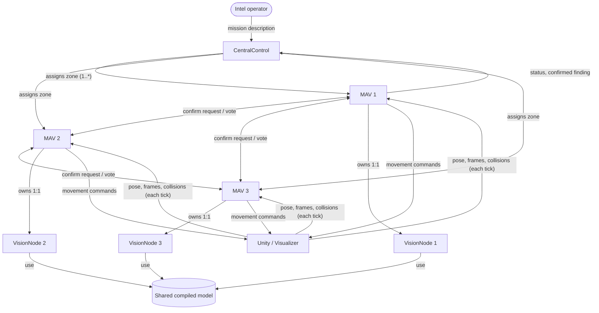

# Agents and relationships

> Status: **Draft** (deliverable: "Identificación de los agentes involucrados")

## Agents

| Agent | Kind | Lives in | Perceives | Decides | Acts / communicates |
|---|---|---|---|---|---|
| **CentralControl** | Deliberative coordinator (1) | `agents/` | Mission description, area bounds, MAV status, confirmed findings | Zone partition, reassignment when a MAV fails or finishes, end of mission | Assigns zones, registers findings, broadcasts mission end |
| **MAV** | Hybrid: reactive (avoidance) + deliberative (patrol, verification) (≥3) | `agents/` | Own pose, battery, neighbors' positions, its VisionNode's detections, messages from peers | Next waypoint, when to ask for confirmation, how to vote | Movement commands to Unity, confirmation requests, votes, reports to CentralControl |
| **VisionNode** | Reactive perception agent (1 per MAV) | `vision/` | Camera frame + camera pose of its MAV, target description | Whether a person is present and whether they match the description (with confidence) | Detections to its MAV only |

### Non-agent participants

| Participant | Role |
|---|---|
| **Intel operator** (external actor) | Provides the textual description of the person of interest and starts the mission |
| **Visualizer / Unity** (environment) | Simulates world, physics, collisions and cameras; renders everything; executes commands. It is the environment of the agents, not a decision maker |
| **Person** (environment entity) | Passive. One is the target, the rest are distractors. Moves or stays still per the scenario |
| **Zone** (environment entity) | Sub-area of the map assigned to one MAV |
| **Shared OpenVINO model** | Resource shared by all VisionNodes (compiled once, ADR 0004) |

## Relationships

| From | To | Relationship | Content |
|---|---|---|---|
| Operator | CentralControl | Mission request | Description, area, number of MAVs |
| CentralControl | MAV | Coordination (1 to many) | Zone assignment, reassignment, mission end |
| MAV | CentralControl | Report | Status (coverage, battery), confirmed finding |
| MAV | MAV | Peer cooperation (many to many) | Confirmation request, proposal to verify, vote, position for separation |
| MAV | VisionNode | Composition (1 to 1) | Frame in, detections out |
| VisionNode | Shared model | Usage (many to 1) | Inference request |
| Unity | MAV | Perception (environment) | Pose, camera frame, collision events |
| MAV | Unity | Action (environment) | Waypoint / velocity commands |

## Scenario walk-through

"Person with an orange jacket in the north quadrant", 3 MAVs.

| # | Agent | Receives | Decides | Communicates |
|---|---|---|---|---|
| 1 | CentralControl | Description + area from the operator | Split the area into 3 zones (north quadrant gets priority) | `assign_zone` to each MAV |
| 2 | MAV 1..3 | Its zone | Lawnmower patrol path inside the zone | `goto` commands to Unity |
| 3 | Unity | Commands | — (environment) | Every tick: poses + frames via `POST /step` |
| 4 | VisionNode 2 | Frame from MAV 2 | Person found, orange upper body, confidence 0.62 (< confirm threshold) | Detection to MAV 2 |
| 5 | MAV 2 | Uncertain detection | Needs confirmation from peers | `confirm_request(position)` to MAV 1 and MAV 3 |
| 6 | MAV 1, MAV 3 | Confirm request | MAV 3 is closer: proposes to verify; MAV 1 keeps patrolling | MAV 3: `propose(eta)`; MAV 1: `refuse(busy)` |
| 7 | MAV 2 | Proposals | Accept MAV 3 | `accept` to MAV 3 |
| 8 | MAV 3 / VisionNode 3 | New view of the position | Match, confidence 0.81 | `vote(yes, 0.81)` to MAV 2 |
| 9 | MAV 2 | Votes: own yes 0.62 + MAV 3 yes 0.81 | Quorum reached (2 of 3 MAVs) | `target_confirmed` to CentralControl |
| 10 | CentralControl | Confirmed finding | Mission success | `mission_end` to all MAVs; finding logged |
| 11 | MAV 1..3 | Mission end | Return / hover | Final commands to Unity |

Thresholds and quorum are proposals; tune them in `protocol.md`.
