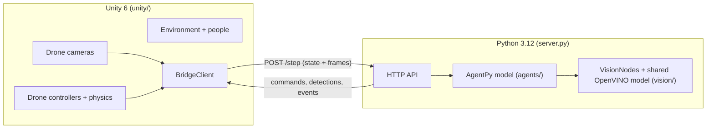

# Architecture

> Status: **Draft**

## Goal

A swarm of at least 3 MAVs patrols a 3D area, avoids collisions, detects a person matching a
text description (e.g. "person with an orange jacket in the north quadrant") with YOLO optimized
by OpenVINO, and confirms the finding by swarm consensus.

**The search ends when:** the target is confirmed by consensus, **or** all zones are covered
without a confirmed finding, **or** the time limit is reached. Success metrics: zone coverage,
registered findings, zero collisions.

## Components



| Component | Responsibility | Does NOT do |
|---|---|---|
| Unity | World, people, physics, collisions, camera rendering, applying commands, visualization | Decide where drones go |
| AgentPy model | Mission, zone assignment, MAV decisions, consensus, termination | Physics or rendering |
| Vision | Person detection + matching against the description, per MAV | Movement decisions |
| `server.py` | Single entry point: HTTP API, decodes frames, calls `model.step()` | Business logic |

## Tick model (ADR 0003)

Unity owns time. Every tick (default **0.5 s** of simulation time) Unity sends the state of all
drones plus one camera frame per drone. Python runs exactly one `model.step()` (including
inference) and replies with commands. Unity keeps simulating with the last commands while it
waits, so the visualization stays fluid; the cost is a small, non-deterministic delay.

```
Unity tick ──POST /step──▶ decode frames ─▶ VisionNode.infer (per MAV) ─▶ model.step() ──▶ reply
   ▲                                                                                        │
   └──────────────────────── apply commands, show detections/events ◀─────────────────────┘
```

## Testing each side alone

- **Unity:** a mock server that returns canned replies from `docs/api.md` examples.
- **Vision:** saved Unity frames instead of live cameras.
- **Agents:** simulated detections instead of the real model.

Integration = run `server.py`, press Play in Unity (see `setup.md`).

## Open questions

- How the target description is matched: YOLO detects `person`; the attribute ("orange jacket")
  needs a second step (e.g. dominant color of the upper-body crop). To be decided by vision.
- How a detection becomes a world position: proposal in `api.md` (project the bbox bottom-center
  onto the ground using the camera pose Unity sends).
- Collision avoidance: Unity physics only detects; avoidance logic in MAV agents (separation
  rule) vs local steering in Unity. To be decided.
