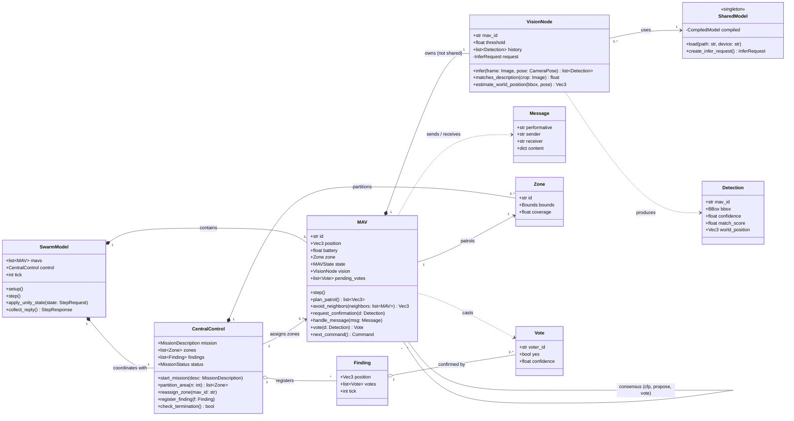
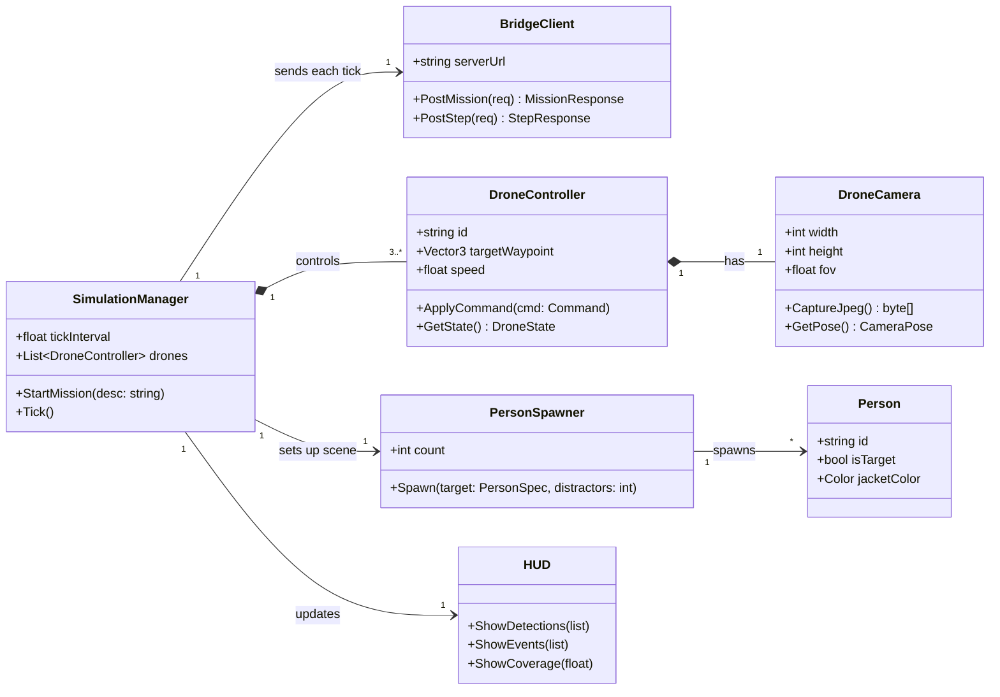

# Class diagram

> Status: **Draft** (deliverable). The vision node is **owned by each MAV** (composition 1:1)
> and all nodes **share one compiled OpenVINO model** (ADR 0004).

## Python side (agents/ + vision/)

## Unity side (unity/)

The two diagrams meet only through `docs/api.md` (`BridgeClient` <-> `server.py`).
