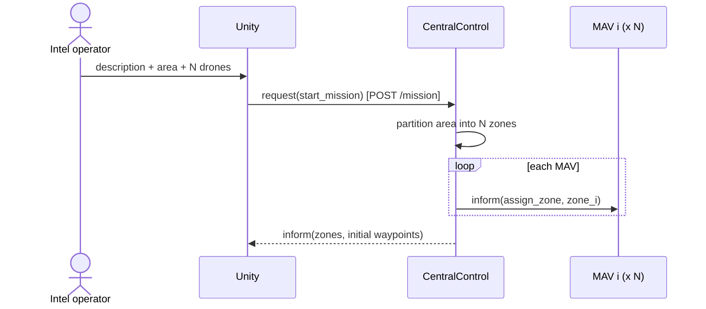
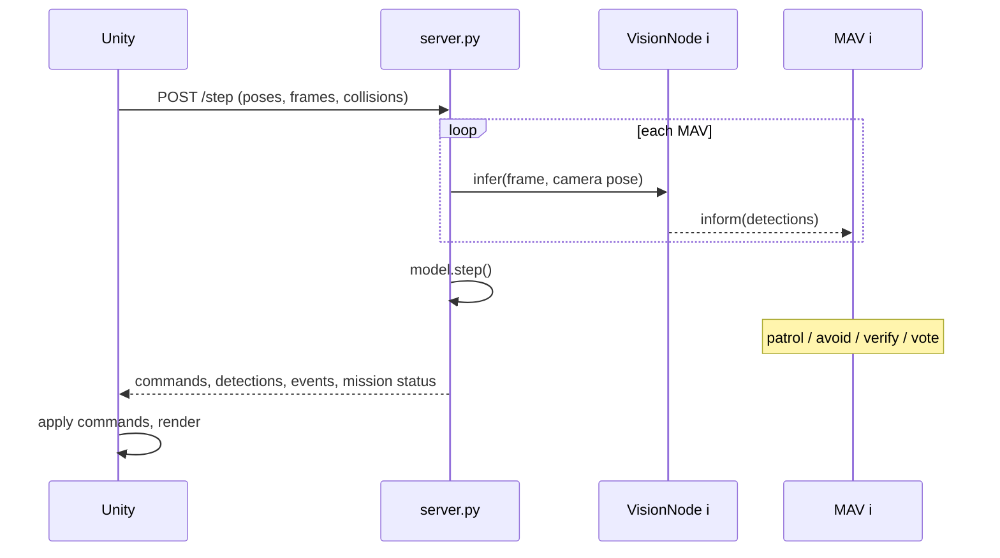
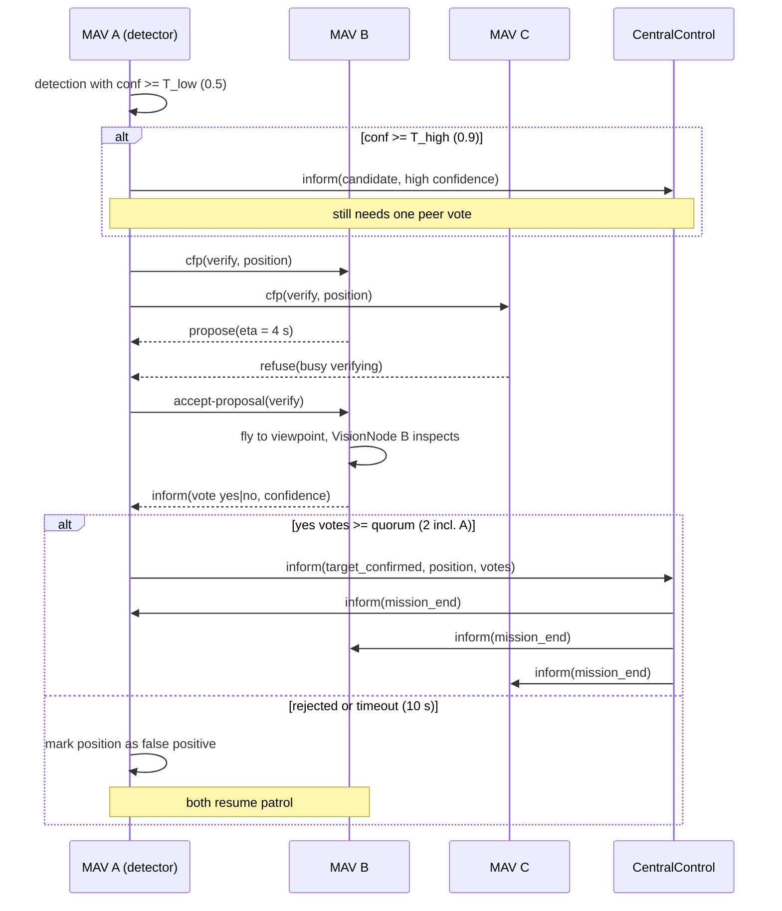
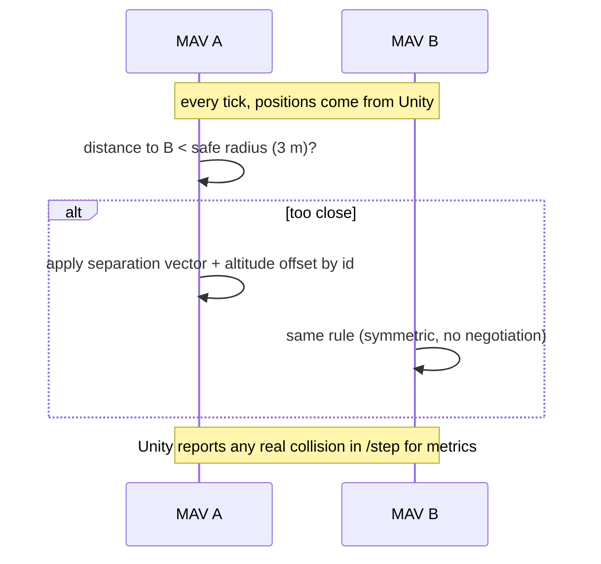

# Interaction protocols

> Status: **Draft** (deliverable: "Diagrama de protocolos de interacción")

An interaction protocol diagram shows **who sends which message to whom, in which order, and
which alternatives exist** (accept/refuse, timeouts). Messages use FIPA-ACL performatives
(`request`, `inform`, `cfp`, `propose`, `accept-proposal`, `reject-proposal`, `refuse`), the usual
vocabulary for multi-agent protocols. Diagrams are Mermaid sequence diagrams (render on GitHub).

## P1. Mission start and zone assignment

## P2. Simulation tick (every 0.5 s, ADR 0003)

## P3. Detection confirmation (swarm consensus)

Contract-Net style: the detecting MAV calls for proposals, the best candidate verifies, and the
finding is confirmed by vote.

## P4. Collision avoidance (local, between neighbors)

## P5. Mission end

| Trigger | Who detects | Message |
|---|---|---|
| Target confirmed | CentralControl (from P3) | `inform(mission_end, success)` to all MAVs |
| All zones covered | CentralControl (from MAV status) | `inform(mission_end, not_found)` |
| Time limit | CentralControl | `inform(mission_end, timeout)` |

## Parameters (initial values, to tune)

| Name | Value | Meaning |
|---|---|---|
| `T_low` | 0.5 | Minimum confidence to start a confirmation |
| `T_high` | 0.9 | High confidence: report a candidate early |
| `quorum` | 2 | Yes votes needed (detector included) |
| `verify_timeout` | 10 s | Max wait for a vote |
| `safe_radius` | 3 m | Separation distance between MAVs |
